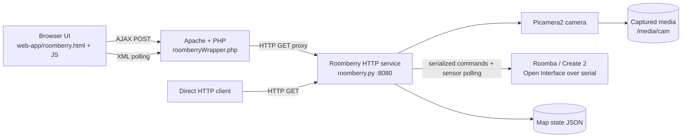
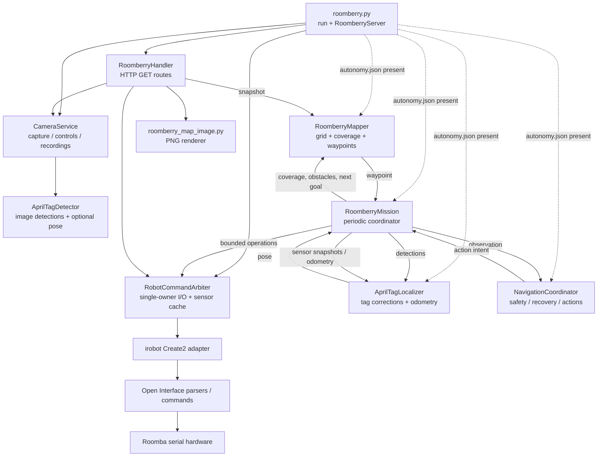
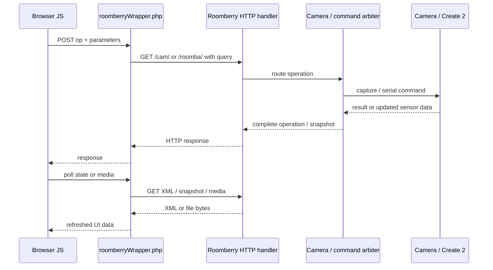
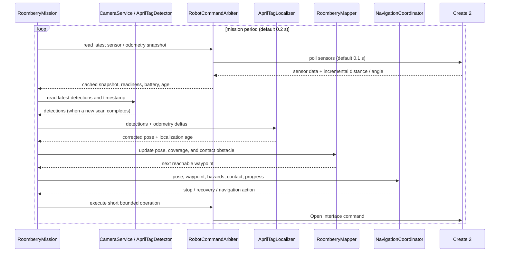

<!-- @(#)architecture.md 1.1 2026/10/25 -->

# Roomberry Architecture

Roomberry is a Raspberry Pi service that exposes camera and Roomba operations over HTTP. When `roomberry/autonomy.json` is present, the service also starts a mission loop that localizes the robot, plans cleaning waypoints, and issues bounded drive commands. Without that configuration, the HTTP API and camera/robot services still run, but mapping and autonomous missions are not created.

## System context

The web application is a separate PHP/Apache frontend. It uses browser JavaScript requests to `roomberryWrapper.php`, which proxies commands and reads to the Python service. Clients can also call the Python HTTP API directly. The Python service owns hardware access and listens on port 8080 by default.

## Python service components

`roomberry/roomberry.py` is the composition root and threaded HTTP server. It creates the robot command arbiter and camera service, and conditionally wires the autonomy components. `RoomberryHandler` routes camera, robot, media, and map requests. The API is implemented with HTTP GET operations and query parameters; examples are in `roomberry/README.md`.

### Hardware and camera ownership

- `RobotCommandArbiter` is the single owner of Create 2 I/O. Its worker services queued operations and polls sensor group 100 about every 100 ms. Callers receive a cached snapshot containing sensors, odometry deltas, readiness, battery state, and age. The arbiter applies motion safety checks and brakes on hazards, stale data, or critical battery conditions.
- The adapter is `roomberry/irobot/robots/create2.py`, backed by Open Interface definitions and parsers under `roomberry/irobot/openinterface/`. The physical link is the configured serial port (default `/dev/serial0`).
- `CameraService` owns Picamera2 and its capture worker. It supports camera controls, on-demand snapshots and recordings, and periodic snapshots. When autonomy is configured, its detector scans frames for AprilTags and publishes the latest detections and their capture/runtime metadata.
- If `camera.pause_for_detection` is enabled, the camera calls mission pause/completion callbacks around a stationary scan. The mission stops first; the camera does not directly resume or command the motors.

### Autonomy responsibilities

- `AprilTagLocalizer` fuses cumulative wheel distance/angle with fresh detections of configured surveyed landmarks. Tag-based pose correction requires calibrated transforms; otherwise tag image detections alone are not room coordinates.
- `RoomberryMapper` tracks a configured finite playfield grid, obstacles, cleaned coverage, and pending/unreachable cells. It returns waypoints and persists map occupancy/coverage atomically to `roomberry/map-state.json` by default. A loaded map does not restore a live pose; localization must reacquire it.
- `NavigationCoordinator` selects an action intent based on mission mode, localization, hazards, bumper state, progress, waypoint, and optional wall signal. It does not issue hardware commands.
- `RoomberryMission` runs the loop (default 0.2 seconds): read sensor snapshot and detections, update localization, update coverage/contact obstacles, ask the mapper for the next waypoint, select a navigation action, then translate it to bounded arbiter operations. It stops and disables cleaning motors on hard safety conditions and on mission shutdown. Low battery switches a cleaning mission to return-to-base behavior.

## Request and autonomous control flows

The API exposes current robot/camera state as XML (`/roomba/roomba.xml`, `/cam/cam.xml`), camera media listing as `/cam/media.xml`, a live snapshot at `/cam/snap.jpg`, stored JPG/H.264 files, and an optional `/map.png` view. Robot operations use `/roomba/?op=...`; camera operations use `/cam/?op=...`. A PHP frontend configuration in `web-app/config.ini` supplies the Roomberry URL and local media/song paths.

When autonomy is enabled, the control loop follows this path. Motion is always dispatched through the arbiter, even though waypoints and actions are computed by higher-level components.

## Data and configuration

| Data | Producer / consumer | Location or interface |
| --- | --- | --- |
| Autonomy calibration and room survey | Read at service startup | `roomberry/autonomy.json` (optional) |
| Robot and camera status | Python API; PHP frontend polls | `/roomba/roomba.xml`, `/cam/cam.xml` |
| Captures and recordings | Camera service; media API and PHP UI browse them | `/media/cam/YYYYMMDD/` |
| Sensor samples | Arbiter polls; optional buffered CSV recorder | `/var/log/roomberry-sensors/` by default |
| Map occupancy, coverage, trail | Mapper persists; map route renders a snapshot | `roomberry/map-state.json` by default; `/map.png` |
| Mission mode and commands | API operations or mission coordinator | `/roomba/?op=...` and autonomy loop |

Autonomy configuration defines the map geometry and robot radius, camera tag family/size/intrinsics, camera-to-robot transform, surveyed tag world transforms, and optional docking and wall-following settings. Coordinates in calibration transforms are meters; mapper pose and waypoints are millimeters. The mission starts in `idle` unless `start_mode` is configured otherwise.

## Operational boundaries

- The Python HTTP server uses `ThreadingMixIn`; HTTP handlers may run concurrently. Device access remains serialized by the arbiter, while the camera and mission each have their own worker threads.
- The PHP frontend is optional and separately hosted. Direct HTTP clients do not require it.
- `/map.png` returns 404 when autonomy mapping is not configured.
- Safety behavior is layered: the navigation/mission logic stops on localization or sensor hazards, while the arbiter independently checks whether requested motion is allowed and brakes when its safety conditions are met.

