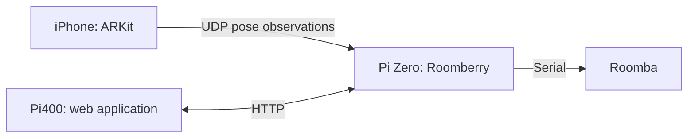

# Plan cross-platform development

> change of direction: use an iphone running an ARKit app to scan the ceiling and communicate position and movement data with the pi zero via udp packets. I created a new folder ios-app for the xcode project. now we have three distinc work areas: the roomberry python code deployed on the pi zero, the web-app running on a separate pi400, and the new ios-app running on an iphone. how can we manage the development accross platforms? as there are between web-frontend and roomberry-backend there will be similar tight interfaces between roomberry and the ios-app. please provide a plan of attack for the development environment. Move all to mac? utilize github integration to bridge gaps?

<details><summary>2 previous messages</summary>

> I’ll look at the repository layout and existing interfaces, then recommend a development workflow for the three platforms.
>
> <details><summary>Searched the web</summary>
>
> Searched the web for `site.developer.apple.com Xcode supported platforms macOS ARKit device testing ...`
>
> Searched the web for `site.developer.apple.com ARKit world tracking coordinate system session reset tracking limited ...`
>
> </details>
</details>

**Use a Mac as the primary development workstation, keep all three components in this repository, and use GitHub for synchronization and automated checks.** The Pi Zero and Pi400 should remain deployment and hardware-testing targets.

You can retain WSL as a second development environment. There is no need to migrate everything before starting the iPhone prototype.

| Component | Development environment | Final validation |
|---|---|---|
| `roomberry/` Python backend | Mac or WSL, with hardware adapters mocked | Pi Zero with Roomba |
| `web-app/` PHP/JavaScript | Mac or WSL with PHP and a backend stub | Pi400 |
| `ios-app/` Swift/ARKit | Mac with Xcode | Physical iPhone on the robot |

Choose an Xcode version compatible with the Mac’s macOS and the phone’s iOS version. Apple maintains the [compatibility table](https://developer.apple.com/xcode/system-requirements).

**Keep one repository and make interfaces a fourth shared work area.**

Your existing architecture already has the right ownership boundary: Roomberry owns navigation, safety, and motor commands. Treat the iPhone as another localization sensor.



Add shared specifications and test data alongside the three applications:

```text
roomberry/
web-app/
ios-app/
interfaces/
    localization-v1.md
    localization-v1.schema.json
    http-api.md
    fixtures/
tools/
    replay-localization
    deploy-roomberry
    deploy-web
docs/
    development.md
```

A single commit can then update the Swift sender, Python receiver, protocol specification, and fixtures together. Separate repositories would add coordination work at this stage.

**Define the localization contract before connecting it to navigation.**

For the first version, I recommend small JSON UDP packets containing:

- Protocol version, sender identity, session ID, and sequence number.
- Capture time from a monotonic clock.
- Full position and orientation, with explicit units and coordinate conventions.
- ARKit tracking state and reason for limited tracking.
- Explicit session reset or coordinate-origin change information.

Start at a configurable 10–20 Hz, keeping each observation within one small datagram. Send complete pose observations so losing one packet does not invalidate subsequent packets.

Put the conversion from the phone’s pose to the robot’s pose in one clearly owned backend adapter. That conversion must include the upside-down mounting orientation, phone-to-robot offset, and alignment with your existing room coordinates.

This matters because ARKit has its own world coordinate system and session origin; it does not automatically know your room map or dock location. Tracking quality and relocalization also change during a session. Apple documents both [world coordinates](https://developer.apple.com/documentation/arkit/understanding-world-tracking) and [tracking lifecycle](https://developer.apple.com/documentation/arkit/managing-session-life-cycle-and-tracking-quality).

On the Pi:

- Reject malformed, duplicate, and out-of-order observations.
- Track packet age using the Pi’s receive clock; phone and Pi monotonic clocks are independent.
- Handle tracking loss and session resets explicitly.
- Feed accepted observations into localization; retain motor authority in the existing command arbiter.

Use reliable HTTP operations for configuration and calibration. UDP is appropriate for a stream of replaceable pose observations.

**Make recorded data the bridge between development environments.**

Build these tools early:

1. A Python pose generator that can send synthetic motion to either a laptop or the Pi.
2. An iPhone recording mode that saves the same observations it transmits.
3. A replay tool that feeds recordings through the backend localization path.
4. Shared valid and invalid packet fixtures consumed by Swift and Python tests.

This lets you reproduce a localization problem on WSL without the phone, and develop the iOS sender against a Mac receiver without moving the Roomba.

Keep Pi-specific serial, GPIO, and camera imports behind hardware adapters. Most localization and navigation work should run on either workstation; actual hardware behavior still needs Pi testing.

**Use GitHub to coordinate code and checks, with direct LAN deployment during development.**

The repository instructions currently describe a local-only repository. Introducing a private GitHub remote would be a deliberate workflow change; I have not changed that setup.

Recommended workflow:

- Clone the repository independently on Mac and WSL.
- Use short feature branches and commit before switching machines.
- Avoid synchronizing working directories through cloud-drive software or network shares.
- Run Linux checks for Python, PHP, JavaScript, and protocol fixtures.
- Run an Xcode build and relevant Swift tests on a macOS CI runner.
- Require interface tests whenever either side of a contract changes.

GitHub CI can check builds and packet compatibility, but physical ceiling tracking needs an iPhone experiment. Start without self-hosted runners; they introduce another machine service to maintain. They remain an option later if hardware automation warrants it. [GitHub’s runner documentation](https://docs.github.com/en/actions/reference/runners/self-hosted-runners)

For deployment, evolve the existing `roomberry/tools/sync-up` script into commands callable from either Mac or WSL. Give each target an explicit destination, configuration, restart procedure, and health check. Record the deployed Git revision so logs identify exactly which backend and frontend were running.

**I would tackle the work in this order:**

1. **Prove ceiling tracking.** Build a minimal iPhone app showing pose and tracking state, with recording. Test the actual mounting, lighting, blank ceiling areas, turns, and a return to the starting point. Agree on acceptable drift before replacing AprilTags.
2. **Establish the shared contract.** Add the specification, fixtures, Python receiver/generator, and Swift encoder tests.
3. **Run localization in observation mode.** Receive and record iPhone poses on the Pi, compare them with wheel odometry, and measure packet gaps and drift.
4. **Integrate localization.** Add room alignment, mounting calibration, reset handling, and tracking-loss behavior behind a configurable localization provider.
5. **Expose diagnostics.** Have Roomberry report tracking state, packet age, session, and accepted pose through its HTTP API for the Pi400 frontend.
6. **Standardize the environment.** Document setup, add GitHub checks, and make deployment repeatable once the prototype has demonstrated useful tracking.

My recommendation is to **start the ARKit prototype on a Mac immediately, while continuing backend work in WSL if convenient**. Move toward the Mac as your daily workstation only as it becomes useful. Shared contracts, replayable recordings, and repeatable deployment will solve the cross-platform coordination problem more effectively than moving every task to one operating system.
