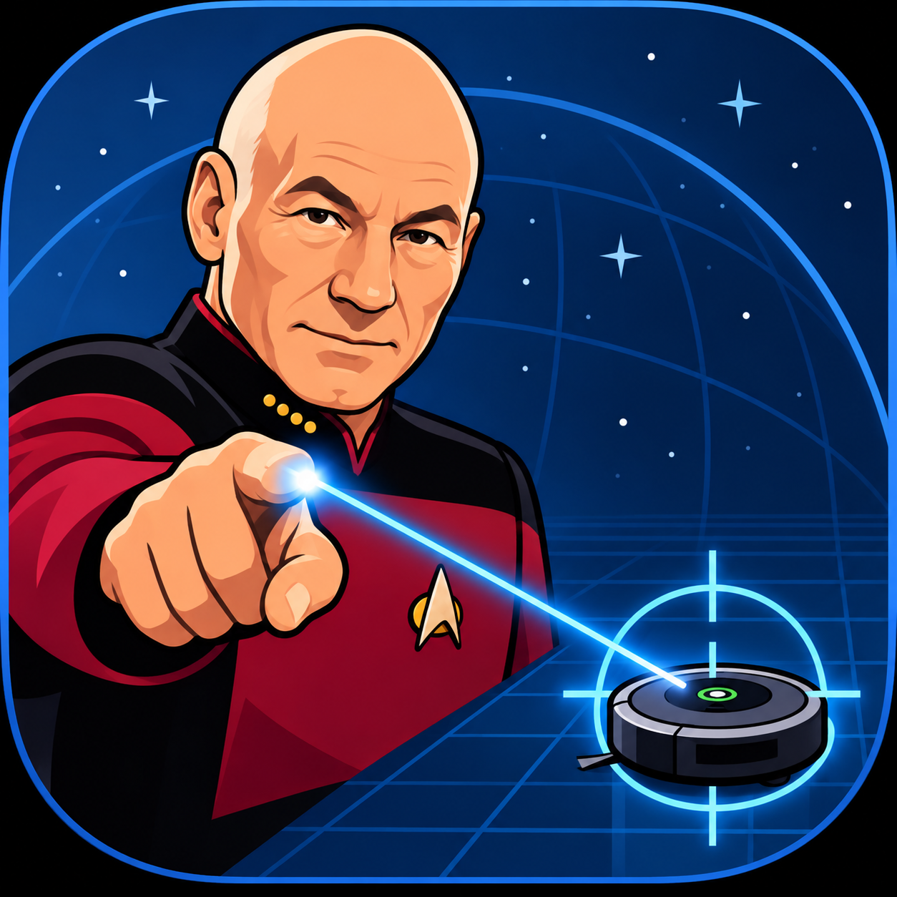

<!-- @(#)ios-app/README.md 2.3.navlink.1 2026/10/30 10:01:30 -->
# iPhone localization for Roomberry

Design outline for an iPhone mounted rigidly on the Roomba with its rear camera facing the ceiling. ARKit estimates motion on the phone; compact UDP messages deliver robot position and heading to the Pi Zero. The Pi retains navigation, wheel odometry, obstacle handling, and all motor authority.

StarLock now sends 128-byte NavLink UDP observations at 10 Hz to `pi:5010`, with `pi.local` as an Avahi fallback. The Python receiver records buffered binary logs. This milestone records session-relative camera pose, IMU diagnostics and phone battery status; surveyed room/mount calibration and navigation integration remain proposed work. See the [NavLink format and manual receiver instructions](../navlink/navlink.md).

- [Implementation and calibration](implementation-plan.md): app structure, coordinate transforms, Pi integration, and delivery phases.
- [Earlier JSON UDP proposal](udp-protocol.md): superseded wire encoding; timing and navigation qualification requirements remain design references.
- [Validation plan](validation-plan.md): bench checks, room trials, failure injection, and provisional acceptance targets.

Develop with Xcode on macOS and test tracking on a physical ARKit-compatible iPhone. Select the deployment target after checking the actual phone and installed Xcode. A simulator can exercise interface/protocol code but cannot validate ceiling tracking.

The first milestone is a foreground app streaming a calibrated pose to a logging-only Pi receiver. Autonomous use follows measured tracking and failure-handling trials. ARKit is relative visual-inertial tracking, not a surveyed absolute indoor positioning system; blank ceilings, poor light, vibration, and relocalization may limit it.

We decided on names for the ios app and the communications link:

StarLock via NavLink it is! 🚀

That gives Roomberry a nice little spacecraft architecture:
- Roomberry — the autonomous rover (Raspberry Pi)
- StarLock — the iOS ARKit tracking and positioning station
- NavLink — the UDP navigation and telemetry protocol
And naturally, some suitably sci-fi status messages:

STARLOCK / NAVLINK
-----------------------------
NAVLINK       CONNECTED
TRACKING      LOCK ACQUIRED
REFERENCE     ESTABLISHED
POSITION      VALID
TELEMETRY     STREAMING
-----------------------------
ROOMBERRY     READY TO NAVIGATE

I added the ARCube example as StarLock to this folder as starting point. The deployment
target is an iphone SE (2016) running ios 15.8. It identifies as "Peters SE".

